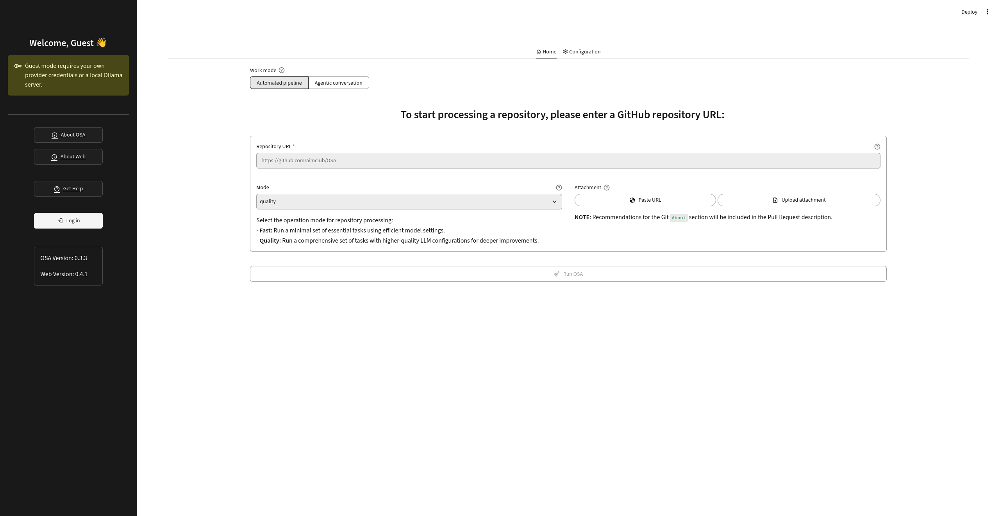
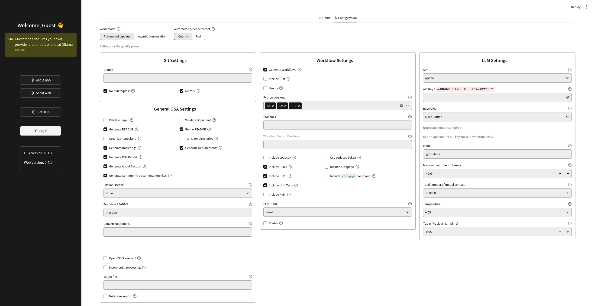
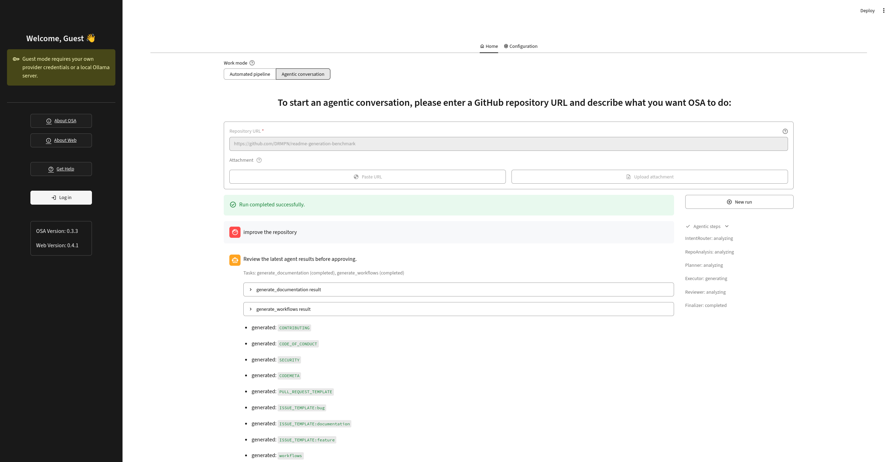
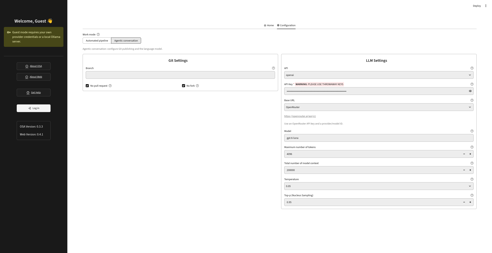

# OSA.Web: Open-Source Advisor Web Interface

<p align="center">


</p>

## Overview

OSA.Web is a Streamlit interface for running [`osa-tool`](https://github.com/aimclub/OSA) against GitHub repositories. It lets a user type in a repository, tune OSA options, attach supporting documents, run the CLI, and download generated reports from the browser.

### Automated pipeline

**Home:** Select the fast or quality preset, enter a repository URL, and start a run.



**Configuration:** Choose the preset and adjust Git, workflow, general, and LLM settings.



### Agentic conversation

**Home:** Chat with the agents, review their work, and follow agentic steps beside the conversation. A completed run shows a success marker and a **New run** button.



**Configuration:** Set Git publishing and LLM options for agentic runs.



The screenshots show example settings and a completed run; the selected values may differ from the defaults.

## Features

- AimClub login or guest mode.
- Fast and quality presets for OSA runs.
- Git, README, documentation, workflow, and LLM settings from the UI.
- Optional PDF or DOCX attachment upload.
- Live console output for automated runs and agentic conversations.
- An Agentic conversation mode on Home for agent progress, clarification, result review, and revisions.
- Download buttons for generated PDF reports.
- Pull request and GitHub About-section feedback when available.

## Installation

Requires Python 3.11+ and OSA `0.3.3`, which adds the web chat protocol and direct OpenAI GPT-6 compatibility. Publish the OSA changes before installing from PyPI or building the Docker image.

```bash
python -m venv .venv
source .venv/bin/activate
pip install -r requirements.txt
```

Install Streamlit's development skills after activating the environment:

```bash
streamlit skills -g -y
```

For development tooling:

```bash
pip install -e ".[dev]"
```

## Configuration

Tracked settings live in the single root `config.toml`. For machine-specific
LLM or workflow settings, set `OSA_WEB_CONFIG` to a TOML override file. Its
values are merged over `config.toml`.

Configuration precedence:

1. `config.toml`
2. `OSA_WEB_CONFIG`, if set

Log and temporary paths are configured separately with `OSA_WEB_LOG_PATH` and
`OSA_WEB_TMP_DIR`. Their defaults are `runtime/logs/osa_web.logs` and
`runtime/tmp`; relative paths resolve from the project root. For example, a
server can set `OSA_WEB_LOG_PATH=/var/essdata/logs/osa_web.logs` and
`OSA_WEB_TMP_DIR=/var/essdata/tmp` in its environment.

Use the Home tab's **Work mode** switch to choose **Automated pipeline** or **Agentic conversation**. The Configuration tab follows that choice. Its automated pipeline preset switch selects fast or quality settings and also updates the preset used on Home. The automated pipeline adds scorecard, incremental processing, target files, notebook reports, Ruff, and uv. Agentic conversation has separate Git and LLM settings; its agents choose tasks from the conversation.

The same **Work mode** switch is available at the top of Configuration, with the
**Automated pipeline preset** switch beside it. For the
OpenAI-compatible API, **Base URL** offers OpenAI, OpenRouter, and Custom.
Custom keeps a text field for another endpoint. OpenRouter requires its own API
key and a model ID in `provider/model` form.

The default provider is the direct OpenAI API: fast and agentic conversation use `gpt-6-luna`, while quality uses `gpt-6-sol`. Set `OPENAI_API_KEY` in `.env`, or enter a provider key in Configuration as a guest. OSA omits unsupported sampling parameters for these GPT-6 models. Before starting a run, Web checks that the configured LLM Base URL responds within three seconds. Authentication and `HEAD` method rejections pass this connection check; server errors and connection failures show the URL before OSA starts.

## Secrets

Create a local `.env` file when you need credentials:

```bash
cp .env.example .env
```

Supported variables:

- `GIT_TOKEN`: optional GitHub token for private repositories and pull request creation.
- `OSA_WEB_CONFIG`: optional path to a TOML config override.
- `OSA_WEB_LOG_PATH`: optional log file path.
- `OSA_WEB_TMP_DIR`: optional temporary directory path.

Do not commit `.env` or real API keys.

## Project Structure

```text
.
├── config.toml               # tracked settings
├── Dockerfile                # container image definition
├── .dockerignore             # Docker build context exclusions
├── src/osa_web/
│   ├── app.py                # Streamlit app composition
│   ├── settings.py           # config loading and path resolution
│   ├── auth/                 # login and auth state
│   ├── ui/                   # Streamlit screens and widgets
│   ├── osa_tool/             # CLI command, runner, and output parser
│   ├── state/                # session-state helpers
│   └── assets/               # packaged static assets
├── tests/
│   └── unit/                 # pure unit tests
├── streamlit_app.py          # compatibility entrypoint
└── requirements.txt
```

## Running

```bash
streamlit run streamlit_app.py
```

The compatibility entrypoint adds `src/` to `sys.path` and calls `osa_web.app.main()`.

Choose **Agentic conversation** on Home, enter a repository URL and an initial request, and optionally add a PDF, DOCX, or public attachment URL with the shared attachment picker. Answer the agents' questions and approve or request revisions there. In either work mode, a run that can create a fork or pull request requires confirmation before it starts. Agentic steps appear beside the chat, and a completed run shows a success marker in place of **Cancel run**. Conversation history lasts for the browser session. Use **New run** to clear it.

Use **See Console Output** below the chat and agentic steps to inspect recent OSA events and stderr. It opens automatically after a fatal error, including provider errors such as HTTP 401. The view remains available until you select **New run**.

Local Streamlit development uses polling for source changes to avoid Linux inotify watch-limit errors. Docker continues to disable file watching.

## Running With Docker

Build the image:

```bash
docker build -t osa-web .
```

Run the app:

```bash
docker run --rm -p 8501:8501 --env-file .env osa-web
```

Then open <http://localhost:8501>.

If you do not need credentials or do not have a local `.env` file, omit `--env-file .env`.

The container uses the tracked `config.toml`. To provide container-specific
settings, mount an override and point `OSA_WEB_CONFIG` at it:

```bash
docker run --rm \
  -p 8501:8501 \
  --env-file .env \
  -e OSA_WEB_CONFIG=/app/override.toml \
  -v "$PWD/override.toml:/app/override.toml:ro" \
  osa-web
```

To persist generated reports and logs between container runs:

```bash
docker run --rm \
  -p 8501:8501 \
  --env-file .env \
  -v "$PWD/runtime:/app/runtime" \
  osa-web
```

## Testing

The test suite covers Streamlit UI behavior and the underlying run and configuration logic:

```bash
PYTHONPATH=src python -m unittest discover tests
```

If development dependencies are installed, this also works:

```bash
pytest
```

GitHub Actions runs Ruff and the unit tests on pull requests targeting `main`
and on pushes to `main`, using Python 3.11 and 3.12. CI installs the pinned
OSA source revision that provides the required `osa-tool` 0.3.3 package.

## Development Notes

- Keep Streamlit widget code inside `src/osa_web/ui/`.
- Keep subprocess and `osa-tool` behavior inside `src/osa_web/osa_tool/`.
- Prefer adding tests around pure logic before wiring it into Streamlit.
- Keep generated repositories, reports, logs, and temp directories out of git.

## Related Links

- OSA: <https://github.com/aimclub/OSA>
- OSA.Web: <https://github.com/ITMO-NSS-team/OSA.Web>
- Helpdesk: <https://t.me/osa_helpdesk>
